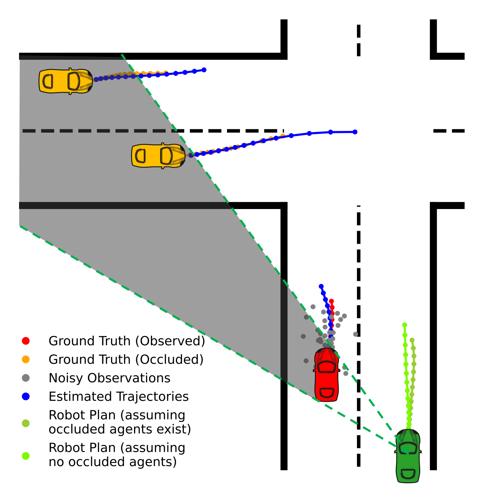

This paper presents an occlusion-aware game-theoretic inference method to estimate the locations of potentially occluded agents, and simultaneously infer the intentions of both visible and occluded agents, which best accounts for the observations of visible agents. Additionally, we propose a receding horizon planning strategy based on an occlusion-aware contingency game designed to navigate in scenarios with potentially occluded agents.

**Links:** [arXiv](https://arxiv.org/abs/2303.09744) · [PDF](https://arxiv.org/pdf/2303.09744.pdf)

